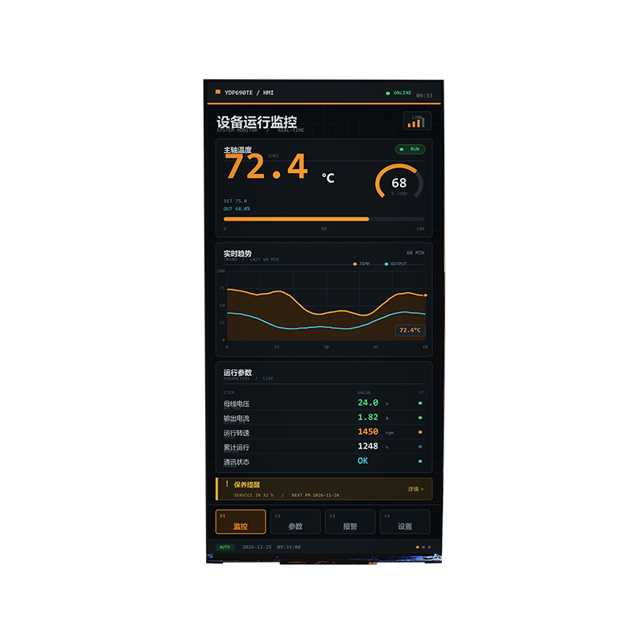

<p align="left"></p>

<h1 align="center">OSPTEK 6.9″ TFT Display 720×1440 (YDP690TE001-V1)</h1>

<p align="center"><b>TFT module · MIPI · ST7121P</b></p>

<p align="center"><a href="./README.md">简体中文</a> | English · <a href="../../README_EN.md">Family index</a></p>

<p align="center">
  
  
  
</p>

<p align="center"></p>

## Contents

- [Specifications](#specifications)
- [Resources](#resources)
- [Repository layout](#repository-layout)
- [Buy](#buy)
- [Support](#support)

---

## Specifications

| Item | Spec |
| ---- | ---- |
| Size | 6.9 inch |
| Type | TFT |
| Resolution | 720×1440 |
| Outline | 80.28 x 162.34 x 2.13 mm |
| Active area | 78.0192 x 156.0384 mm |
| Interface | MIPI |
| Driver IC | ST7121P |
| Touch IC | ST7121P |

> Full outline, FPC definition, power, and timing follow the product datasheet / driver IC datasheet.

## Resources

| Category | File |
| ---- | ---- |
| Datasheet | [`ST7121P_Datasheet_V1.1.pdf`](./datasheets/ST7121P_Datasheet_V1.1.pdf) |
| Datasheet | [`YDP690TE001-V1.pdf`](./datasheets/YDP690TE001-V1.pdf) |
| CAD file | [`YDP690TE001-V1.dwg`](./cad/YDP690TE001-V1.dwg) |
| Adapter materials | [`未标题-1.png`](./adapter/%E6%9C%AA%E6%A0%87%E9%A2%98-1.png) |

## Repository layout

```text
display-tft-6.9inch-720x1440/ # repo root (nav: ../../README_EN.md; sample projects under root examples/)
└── versions/
    └── YDP690TE001-V1/        # full materials for this part number
        ├── README.md
        ├── README_EN.md
        ├── osptek.yml
        ├── images/
        ├── datasheets/       # product datasheet + driver/touch IC datasheets
        ├── cad/              # outline/cover CAD
        └── adapter/          # adapter board materials + photos
```

## Buy

See the [repo home page](../../README_EN.md#where-to-buy).

## Support

See the [repo home page](../../README_EN.md#support).

---

<p align="center"><sub>© 2026 OSPTEK · Materials in this repository are licensed under CC BY 4.0</sub></p>
